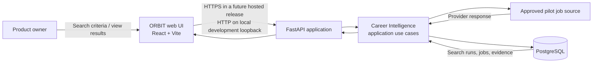
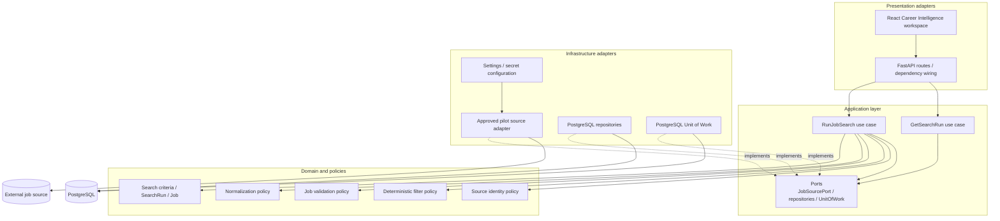
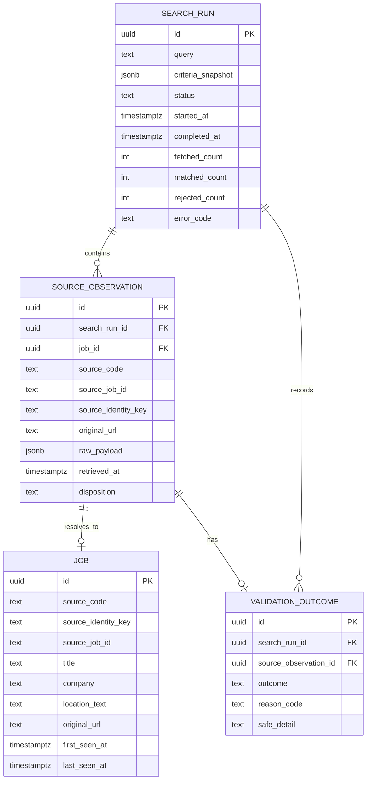

# PIYVIAN ORBIT — High-Level Design (HLD)
## Career Intelligence: Job Discovery v1

**Product:** PIYVIAN ORBIT  
**Company:** PIYVIAN TECHNOLOGIES  
**Document ID:** ORBIT-HLD-CI-JD-001  
**Version:** 0.1  
**Status:** Draft for review  
**Prepared:** 31 October 2026  
**Requirements baseline:** Career Intelligence — Job Discovery v1 SRS v0.1 (approved by the user in the project conversation on 31 October 2026)  
**Product reference:** PIYVIAN_ORBIT_Product_Blueprint_SRS_HLD_SDLC_Roadmap.pdf, Draft v0.1, 27 October 2026

> This HLD describes the architecture for the first Job Discovery vertical slice. It preserves the complete PIYVIAN ORBIT product vision and does not narrow the future Career Intelligence source strategy or remove any specialist agent from the product baseline.

---

## 1. Purpose

This document translates the approved Job Discovery v1 requirements into a high-level technical architecture. It identifies the system's major components, their responsibilities, boundaries, data flow, persistence model, API surface, security controls, operational behavior, and test strategy.

The HLD is intentionally not a line-by-line implementation specification. Detailed Python types, exact SQL DDL, Pydantic request/response schemas, exact HTTP status contracts, UI component specifications, and connector-specific mappings belong in the Low-Level Design (LLD) and implementation tasks.

## 2. Design summary

Job Discovery v1 will be built as a **local-first modular monolith** with:

- a React/Vite browser interface;
- a FastAPI backend;
- an application/use-case layer that coordinates a manual search;
- a small domain layer containing job/search concepts and business rules;
- a replaceable job-source port with one approved pilot adapter;
- PostgreSQL persistence for search runs, source observations, normalized jobs, and validation outcomes.

The system will use deterministic Python logic for retrieval orchestration, normalization, validation, filtering, idempotency, and persistence. No LLM, agent framework, vector database, scheduler, message broker, or microservice is necessary for this slice.

### 2.1 Proposed technology direction

| Concern | Proposed choice | Rationale / qualification |
|---|---|---|
| Backend language | Python | Matches the product's planned backend and learning goals. |
| API framework | FastAPI | Consistent with the BRD/SRS technology direction. |
| API/domain validation | Pydantic | Consistent with the SRS direction; exact version is an implementation dependency decision. |
| Persistence | PostgreSQL | Required system of record for this slice. |
| ORM and migrations | SQLAlchemy 2.x + Alembic | Recommended implementation choice; confirm during LLD/dependency selection. |
| Frontend | React + Vite | Consistent with the SRS technology direction. |
| Frontend tests | Vitest + React Testing Library | Proposed test tooling; confirm when frontend setup is designed. |
| Backend tests | pytest + FastAPI TestClient | Proposed test tooling; connector tests will use fixtures/fakes. |
| Local configuration | environment variables + `.env` excluded from Git | Keeps secrets and machine-specific configuration out of source control. |

The table is a design proposal, not a claim that all dependencies have already been installed or version-pinned.

## 3. Scope and system boundary

### 3.1 Included

- User-triggered manual job search.
- One approved source connector, selected only after a permission, terms, coverage, rate-limit, and technical-feasibility review.
- Search-run lifecycle and persisted criteria.
- Source retrieval and traceable raw source observations.
- Normalization into a common ORBIT job representation.
- Required-field validation and validation outcomes.
- Deterministic filtering for supported criteria.
- Source-scoped idempotent job persistence.
- Result retrieval and display in the Career Intelligence workspace.
- Structured operational logging and automated tests.

### 3.2 Excluded

Scheduled searches, multiple production connectors, full connector registry, fuzzy cross-source deduplication, advanced matching/ranking, Master Career Profile, Resume Intelligence, Application Tracker workflows, email integrations, RAG, LLMs, LangChain, LangGraph, Deep Agents, MCP, LangSmith, vector databases, multi-user SaaS, billing, and native mobile applications are excluded from this slice. They remain in the broader roadmap.

### 3.3 System context



The provider is an external, untrusted system. The browser never connects directly to the provider or PostgreSQL. All source access and database access occur through the backend.

## 4. Architecture principles and decisions

The following are the proposed architecture decisions for review.

### ADR-JD-001 — Use a modular monolith

**Decision:** Build one backend application with clear internal modules rather than microservices.

**Why:** The first release has one user, one provider, one workflow, and a small operational footprint. Separate services would add deployment, networking, observability, and consistency costs without a demonstrated need.

**Consequence:** Module boundaries must be clear, but they do not need separate deployments. Future extraction is possible only if real scaling or ownership needs justify it.

### ADR-JD-002 — Apply Hexagonal Architecture at the source and persistence boundaries

**Decision:** The application/use-case layer depends on interfaces (ports), not concrete provider or database implementations. Provider and database integrations implement those ports as adapters.

**Why:** The job provider may change, and tests must run without calling a live source. This also teaches dependency inversion and makes later connector expansion safer.

**Consequence:** Avoid creating interfaces for every trivial function. Introduce a port where an external dependency or replaceable boundary exists.

### ADR-JD-003 — Use a bounded synchronous search for v1

**Decision:** Prefer a single bounded request/response workflow for the first local MVP: the API creates the run, invokes the connector with strict timeouts and result limits, persists the outcome, and returns the run identifier/status. The UI displays a loading state during the operation and then loads the persisted run.

**Why:** There is no scheduler or durable background-worker requirement in this slice. A queue would add operational complexity.

**Guardrail:** The connector must have bounded pagination, response-size limits, and timeouts. If source feasibility testing shows the provider routinely exceeds practical HTTP request limits, revise this decision before implementation; do not silently add an in-process background task that can be lost on restart.

### ADR-JD-004 — PostgreSQL is the source of truth

**Decision:** Persist search runs, normalized jobs, source observations, and validation outcomes in PostgreSQL. The browser holds only transient UI state.

**Why:** Search results must survive refresh, and database constraints/transactions are needed for reliable idempotency.

### ADR-JD-005 — Preserve provider evidence separately from normalized fields

**Decision:** Store source observations and raw provider records separately from the normalized job representation.

**Why:** Provider payloads are source evidence; normalization is an application interpretation that may change as mapping rules evolve.

**Guardrail:** Raw payloads are untrusted data. They must not be executed, rendered as HTML, copied into routine logs, or treated as application instructions.

### ADR-JD-006 — Use source-scoped idempotency, not fuzzy deduplication

**Decision:** Identify a posting using a stable provider ID when available. If the provider has no stable ID, use a documented source-specific fallback such as a canonicalized original posting URL. Enforce uniqueness within the pilot source.

**Why:** Repeat searches must not create uncontrolled duplicate rows, while uncertain cross-source merges are explicitly deferred.

**Guardrail:** Do not use company/title/location similarity as an automatic merge rule in v1. Do not claim that source-scoped identity solves cross-source duplicates.

### ADR-JD-007 — Do not use an LLM in this slice

**Decision:** All decisions that affect retrieval, validation, filtering, and persistence are deterministic.

**Why:** Job Discovery v1 is intended to prove the data pipeline and source integration before adding AI reasoning. A model would add cost and nondeterminism without satisfying a v1 requirement.

## 5. Logical component architecture



### 5.1 Responsibilities

| Component | Responsibility | Must not do |
|---|---|---|
| React workspace | Collect criteria; show loading, results, empty and error states; open original links. | Call the provider or database directly; contain provider credentials. |
| FastAPI routes | Parse/validate HTTP input, invoke use cases, map outcomes to HTTP responses. | Contain provider-specific parsing or business rules. |
| `RunJobSearch` use case | Coordinate the search-run lifecycle and pipeline. | Depend directly on a concrete provider SDK or ORM session implementation. |
| `GetSearchRun` use case | Retrieve a persisted run and its results. | Re-fetch provider data as a side effect. |
| Domain models/policies | Express job/search concepts, validation rules, deterministic filtering and identity rules. | Import FastAPI, SQLAlchemy, React, or provider SDKs. |
| Pilot source adapter | Make authorized provider requests and map provider response envelopes into source records. | Decide ORBIT-wide business eligibility or expose secrets to the UI. |
| PostgreSQL repositories | Load/save domain records and implement persistence queries. | Contain provider HTTP logic. |
| Unit of Work | Define transaction boundaries for related writes. | Keep a database transaction open while waiting on external network calls. |

### 5.2 Dependency direction

Dependencies point inward:

- The domain layer knows nothing about FastAPI, PostgreSQL, or the provider.
- The application layer knows domain concepts and port contracts.
- Infrastructure adapters implement those contracts.
- The API layer and composition root connect concrete adapters to the use cases.

This is the practical application of the Dependency Inversion Principle: the high-level search workflow does not depend on the low-level provider client or database library.

## 6. Main runtime flow

### 6.1 Manual search sequence

```mermaid
sequenceDiagram
    actor User
    participant UI as React UI
    participant API as FastAPI
    participant UC as RunJobSearch
    participant DB as PostgreSQL
    participant SRC as Pilot source adapter
    participant EXT as External job source

    User->>UI: Enter criteria and submit
    UI->>API: POST /api/v1/career/search-runs
    API->>UC: execute(criteria)
    UC->>UC: Validate search criteria
    UC->>DB: Create RUNNING search run
    DB-->>UC: run_id
    UC->>SRC: search(criteria, bounded limits)
    SRC->>EXT: Authorized provider request(s)
    EXT-->>SRC: Provider response
    SRC-->>UC: SourceBatch(raw records + metadata)
    loop For each source record
        UC->>UC: Preserve raw record; normalize; validate
        UC->>UC: Apply supported deterministic filters
        UC->>DB: Persist observation, outcome and job/upsert
    end
    UC->>DB: Complete run and commit result transaction
    DB-->>UC: Commit successful
    UC-->>API: SearchRunSummary
    API-->>UI: run_id + status + counts
    UI->>API: GET /api/v1/career/search-runs/{run_id}
    API->>DB: Load run and matched jobs
    DB-->>API: Persisted run/results
    API-->>UI: Run detail + results
    UI-->>User: Display jobs and source links
```

### 6.2 Processing rules

1. Validate the request before calling the provider.
2. Create a search-run record with `RUNNING` status and commit it before the external request. Do not hold a database transaction open during the provider call.
3. Call the pilot connector with a finite timeout, finite page/result limit, and provider-specific rate-limit handling.
4. Preserve each returned raw record and retrieval metadata.
5. Normalize provider fields into the application-owned job model.
6. Validate required fields. Invalid records receive a recorded reason and do not abort otherwise valid records.
7. Apply only deterministic filters supported by the source and v1 rules.
8. Upsert normalized job identity by source-scoped identity. Store each observation so repeated retrieval remains auditable.
9. Persist observations, validation outcomes, jobs, and final run counts within a bounded database transaction (or bounded batches if source constraints require this, with explicit partial-result semantics).
10. Mark the run `COMPLETED`, `COMPLETED_WITH_ISSUES`, `EMPTY`, or `FAILED` as appropriate, then return only after the final persistence outcome is known.

**Transaction failure rule:** If the result transaction fails, roll it back and do not report success. Attempt to mark the run failed in a separate short transaction. If PostgreSQL itself is unavailable, the failure state may not be writable; return a sanitized API error and log the correlation/run identifier where possible.

## 7. Domain and data design

This is the logical data model. Exact SQL types, constraints, index definitions, retention policies and migrations belong in the LLD.

### 7.1 Entity relationship overview



### 7.2 Logical records

**SearchRun** — One user-initiated manual search. Stores the immutable criteria snapshot, lifecycle status, timestamps, counts, and safe error summary.

**Job** — The normalized provider posting used by the UI. In v1 the identity is scoped to the one provider. It stores source identity, normalized fields, and first/last-seen timestamps.

**SourceObservation** — One observation of a source posting during one search run. It preserves the raw payload (e.g. PostgreSQL JSONB), source metadata, retrieval timestamp, original URL, and reference to the normalized job when one can be created. A repeated search creates another observation but should resolve to the same source-scoped Job.

**ValidationOutcome** — A machine-readable outcome for a record that is incomplete, invalid, or otherwise rejected. It should retain a safe reason code and reference the source observation/search run. It must not duplicate the full raw payload.

### 7.3 Identity and uniqueness

The pilot adapter/domain mapping must produce a stable `source_identity_key`:

- preferred: `provider-id:<stable-provider-id>`;
- fallback: `canonical-url:<canonicalized-original-url>`.

The exact canonicalization rules must be documented for the chosen provider. Do not remove URL components that are required to distinguish postings. Do not canonicalize unrelated providers with one guessed universal rule.

A database uniqueness constraint should enforce `(source_code, source_identity_key)` for normalized jobs. This is the final guard against concurrent or repeated inserts. Provider IDs and URLs should also be retained in their original/source form for traceability.

### 7.4 Suggested job field groups

- Identity: `id`, `source_code`, `source_job_id`, `source_identity_key`.
- Core fields: `title`, `company_name`, `description` or summary.
- Location/work: `location_text`, structured country/location when available, `work_arrangement`, `employment_type`.
- Source facts: `original_url`, `source_posted_at`, `source_updated_at`, `source_salary_text`, `source_currency`, `source_salary_period`, `source_sponsorship_text`.
- ORBIT timestamps: `first_seen_at`, `last_seen_at`, `created_at`, `updated_at`.
- Provenance: reference to source observations rather than treating normalized columns as raw evidence.

Optional source facts remain null/unknown when not supplied. No inferred salary, sponsorship, eligibility or work authorization is stored as a provider fact.

### 7.5 Persistence and indexes

Recommended minimum indexes/constraints for LLD:

- primary keys on all tables;
- unique source identity on `Job(source_code, source_identity_key)`;
- index `SourceObservation(search_run_id)` for run result retrieval;
- index `SourceObservation(job_id)` for observation history;
- index `SearchRun(started_at DESC)` for recent search history;
- index `Job(last_seen_at DESC)` for recency sorting;
- appropriate NOT NULL/check constraints for status and identity fields;
- foreign keys with deliberate delete behavior (avoid cascading away evidence accidentally).

The raw payload is stored as JSONB only for traceability and source-specific inspection. Do not create a GIN index until a demonstrated query requirement exists.

## 8. API design

The exact Pydantic schemas, field constraints and response examples belong in the API LLD. The following is the proposed v1 REST surface.

| Method | Endpoint | Purpose |
|---|---|---|
| `POST` | `/api/v1/career/search-runs` | Validate and execute one manual search; return run ID, final/current status and summary counts. |
| `GET` | `/api/v1/career/search-runs/{run_id}` | Retrieve a persisted search-run summary and its result page. |
| `GET` | `/api/v1/career/search-runs` | Optional lightweight recent-run history; include only if accepted as the simplest way to reopen prior results. |

### 8.1 Search request (illustrative)

```json
{
  "query": "Python Developer",
  "locations": ["Germany"],
  "filters": {
    "work_arrangement": ["remote", "hybrid"],
    "employment_type": []
  }
}
```

The exact fields must be reconciled with the pilot provider's actual search contract. Unsupported criteria must be rejected or explicitly reported as unsupported; they must not be silently shown as applied.

### 8.2 Search response (illustrative)

```json
{
  "run_id": "<uuid>",
  "status": "COMPLETED_WITH_ISSUES",
  "counts": {
    "fetched": 25,
    "matched": 18,
    "rejected": 2,
    "duplicates_observed": 5
  }
}
```

No literal IDs or counts in this example represent live provider data.

### 8.3 Run-detail response (illustrative)

```json
{
  "run_id": "<uuid>",
  "status": "COMPLETED",
  "criteria": {
    "query": "Python Developer",
    "locations": ["Germany"]
  },
  "started_at": "<ISO-8601 timestamp>",
  "completed_at": "<ISO-8601 timestamp>",
  "results": [
    {
      "job_id": "<uuid>",
      "title": "Python Developer",
      "company": "Example GmbH",
      "location": "Berlin, Germany",
      "work_arrangement": null,
      "source": "pilot-provider",
      "original_url": "https://example.invalid/jobs/123",
      "source_posted_at": null
    }
  ]
}
```

This is a shape illustration only. In an actual implementation, example domains must be replaced by test fixtures and never be presented as real jobs.

### 8.4 API behavior

- Use a consistent error response envelope with a safe machine-readable code and user-safe message.
- Request validation errors should identify the affected field.
- A missing run ID should return not found without invoking the provider.
- A provider failure should return a controlled upstream error and preserve the run's safe failure state where the database is available.
- A database failure must never return a successful-save response.
- Add pagination to result retrieval only if the pilot's bounded maximum result size requires it; decide exact pagination in the API LLD.

## 9. Connector boundary

### 9.1 Port contract (conceptual)

The application should call a provider-independent contract conceptually similar to:

```python
class JobSourcePort(Protocol):
    def search(self, criteria: SearchCriteria) -> SourceBatch:
        """Retrieve a bounded batch of source records."""
```

`SearchCriteria`, `SourceBatch`, and `SourceRecord` are conceptual types at HLD stage, not code to copy as a finished implementation. The LLD will specify sync/async behavior, metadata, error types, pagination, and rate-limit details after the provider is selected.

### 9.2 Adapter responsibilities

The pilot adapter is responsible for:

- provider-specific request construction;
- authorized authentication/configuration;
- timeout, rate-limit, and bounded-pagination handling;
- provider response envelope parsing;
- preserving the original raw record and provider metadata;
- mapping source identifiers and raw fields into a source-neutral transport record;
- translating provider errors into known connector error categories.

The adapter is not responsible for ORBIT-wide matching scores, broad cross-source deduplication, application status, or AI reasoning.

### 9.3 Connector decision gate

No provider will be named in this HLD. The source decision record must be completed first and include official documentation/permission basis, terms, auth requirements, limits, supported geography, available fields, IDs/URLs, attribution, test fixtures, and risks. The connector is not to be implemented against undocumented or unauthorized scraping behavior.

## 10. Failure handling and resilience

| Failure | Expected behavior |
|---|---|
| Invalid user criteria | Reject before provider invocation; show field-level validation. |
| Provider timeout / network failure | Stop bounded retrieval, mark run failed where possible, return safe error. |
| Provider rate limit | Respect provider guidance; do not retry in a tight loop; record safe category and retry-after metadata if supplied. |
| Provider schema change | Adapter parsing fails safely; record connector error; do not silently mis-map fields. |
| One malformed source record | Record validation outcome and continue processing other records. |
| Missing optional source field | Preserve as null/unknown; valid job can still be displayed. |
| Duplicate in same response | Reuse the same normalized Job identity; preserve each observation if needed for audit; count duplicate observation. |
| Duplicate in later search | Reuse the existing source-scoped Job and update `last_seen_at`; create new observation for the new run. |
| Database write failure | Roll back the result transaction; do not report saved results; best-effort mark run failed. |
| Browser refresh | Reload persisted run and results by `run_id`; do not repeat provider search. |
| Unsafe source text | Store as data and render as plain text; never execute provider-supplied HTML/script. |

Retries should be conservative and limited to explicitly transient failures. Retry behavior must be idempotent and must respect provider rate limits. Do not add automatic retry loops before source-specific rules are documented.

## 11. Security and privacy architecture

1. **Local boundary:** During local development, bind the backend to loopback (`127.0.0.1`) by default. Do not make the development server internet-accessible.
2. **Secrets:** Store provider credentials only in local environment configuration or an appropriate secret store. Commit `.env.example` with placeholder names only; never commit `.env`, tokens, passwords, or real credentials.
3. **Repository:** Continue using `.gitignore` for `.env*` and virtual environments; inspect staged files before every commit because the GitHub repository is currently public.
4. **Browser boundary:** The frontend must never receive provider credentials or direct database connection details. Configure CORS narrowly for the local frontend origin.
5. **Untrusted content:** Escape/render job titles and descriptions as text, validate URLs, allow only appropriate `http`/`https` external links, and use safe external-link attributes.
6. **Logs:** Never log credentials or entire provider payloads. Log source code, run ID, counts, elapsed time, and safe error categories.
7. **Data minimization:** Retain only fields needed for discovery and traceability. The raw payload retention and deletion/export rules are open decisions before hosted deployment.
8. **Future hosted release:** Authentication, authorization, HTTPS, secure cookie/token policy, rate limiting, CSRF considerations where applicable, backups, restore testing, and deployment hardening are mandatory design gates before public exposure.

The local personal MVP must not be mistaken for a production-secure hosted release.

## 12. Observability

For v1, implement a lightweight structured logging foundation; do not add LangSmith or a distributed tracing platform simply to satisfy a technology checklist.

Each search should have a correlation identifier (the `search_run_id` once created). Emit structured events for:

- search requested and validation outcome;
- run created/completed/failed;
- connector start/end, duration, records fetched, and safe error category;
- normalization/validation totals;
- new jobs, existing jobs and duplicate observations;
- persistence commit/rollback outcome.

Metrics worth measuring during pilot testing include request duration, provider response duration, number of pages/records, valid/rejected/matched counts, and persistence duration. Do not record personal secrets or raw job payloads in routine logs.

## 13. Test architecture

Tests must validate behavior without depending on the live provider for ordinary development runs.

| Test level | What to verify | Test boundary |
|---|---|---|
| Domain unit tests | Required-field validation, optional fields, deterministic filters, source identity key, normalization edge cases. | Pure Python; no network or database. |
| Use-case unit tests | Search lifecycle, counts, partial record issues, source failures, no results, idempotent outcomes. | Fake `JobSourcePort`, fake repositories/unit of work. |
| Connector adapter tests | Request mapping, response parsing, pagination limits, timeout/rate-limit translation. | Saved provider fixtures and mocked HTTP responses. |
| Repository integration tests | Constraints, transactions, upsert behavior, JSONB payload storage, observation history. | Dedicated test PostgreSQL database. |
| API tests | Request validation, status/error mapping, run retrieval, no provider call for invalid input. | FastAPI TestClient with dependency overrides. |
| Frontend tests | Form validation, loading/empty/error/result states, safe display of untrusted text, original link rendering. | React component tests with mocked API. |
| End-to-end smoke test | Submit a search against a fake/local fixture adapter and reload the saved run. | Local app and test database; no external source dependency. |

### Required test scenarios

Cover the SRS edge cases: blank query, unsupported location/filter, empty provider response, missing optional field, missing required field, invalid URL, repeated posting in one response, repeated posting across runs, timeout, rate limit, schema mismatch, database outage, page refresh, unsafe text, and prompt-like instructions embedded in job text.

## 14. Proposed repository structure

This is a target structure to refine alongside the current repository. It is not a command to create every file at once.

```text
piyvian-orbit/
├── backend/
│   ├── pyproject.toml
│   ├── .env.example
│   ├── alembic.ini
│   ├── alembic/
│   │   └── versions/
│   ├── src/
│   │   └── orbit/
│   │       ├── main.py
│   │       ├── config/
│   │       │   └── settings.py
│   │       ├── career_intelligence/
│   │       │   ├── domain/
│   │       │   ├── application/
│   │       │   ├── ports/
│   │       │   ├── adapters/
│   │       │   │   ├── inbound/
│   │       │   │   └── outbound/
│   │       │   └── api/
│   │       └── shared/
│   └── tests/
│       ├── unit/
│       ├── integration/
│       └── api/
├── frontend/
│   ├── package.json
│   └── src/
│       ├── app/
│       ├── features/
│       │   └── career-intelligence/
│       ├── components/
│       └── lib/
├── docs/
│   ├── BRD.md
│   ├── status.md
│   ├── SRS_Career_Intelligence_Job_Discovery_v1.md
│   └── HLD_Career_Intelligence_Job_Discovery_v1.md
├── .gitignore
└── README.md
```

### Structure guidance

- `domain/`: framework-independent business models and policies.
- `application/`: use cases coordinating domain rules and ports.
- `ports/`: interfaces for provider access, repositories, and transaction management.
- `adapters/outbound/`: pilot connector and PostgreSQL implementations.
- `adapters/inbound/` / `api/`: HTTP-facing controller/route layer (choose one consistent pattern in LLD; avoid duplicate routing layers).
- `shared/`: only genuinely cross-module primitives; do not turn it into a miscellaneous dumping ground.

The project should remain a modular monolith. The proposed structure creates seams without creating multiple deployable services.

## 15. Implementation sequence and learning plan

We will implement this HLD incrementally. Each step begins with a concept explanation and a small design exercise; then you write the code and receive review/hints.

| Step | Build outcome | Concepts taught |
|---|---|---|
| 1 | Confirm development tooling and backend package skeleton | Python packages, imports, virtual environments, dependency management, Git workflow. |
| 2 | Domain models and search criteria validation | Types, dataclasses/Pydantic boundary models, invariants, functions and error handling. |
| 3 | Source port and fake adapter | Protocols/interfaces, dependency inversion, test doubles, SOLID. |
| 4 | Normalization, validation and source identity policy | Pure functions, dictionaries/sets, idempotency, algorithmic complexity, DSA reasoning. |
| 5 | PostgreSQL schema and migrations | Relational modelling, primary/foreign keys, uniqueness, indexes, transactions. |
| 6 | Search use case with fake source | Orchestration, ports/adapters, use-case testing, sequence dry runs. |
| 7 | Pilot source decision and adapter | HTTP, API terms, authentication, timeouts, pagination, rate limits, untrusted data. |
| 8 | FastAPI endpoints | REST, Pydantic schemas, HTTP status codes, dependency injection. |
| 9 | React search/results workspace | Component boundaries, state, forms, async requests, accessible error states. |
| 10 | Integration and end-to-end verification | Test pyramid, fixtures, integration testing, regression, debugging. |
| 11 | Documentation and local runbook | SDLC, release checklist, Git history, reproducible setup. |

Interview preparation will be paired with the relevant step: Python collections and complexity, OOP/SOLID, dependency inversion, REST/API design, SQL/transactions/indexing, testing strategy, and modular-monolith HLD/LLD trade-offs.

## 16. Open architecture decisions

These decisions remain open and must be closed in the decision log/LLD before the corresponding implementation:

1. **Pilot source:** provider, official access/permission basis, terms, supported countries, data fields, source IDs, pagination and limits.
2. **Execution mode validation:** confirm bounded synchronous execution is reliable for the chosen provider; revise if measured source latency makes it unsuitable.
3. **Exact search filters:** expose only filters reliably supported by the source or deterministically enforceable by ORBIT.
4. **Raw payload retention:** fields to preserve, retention duration, redaction needs, and deletion/export behavior.
5. **Identity fallback:** provider-specific canonical URL rules if no stable source ID exists.
6. **Run history UI:** decide whether v1 includes a small recent-search list or only re-opening a run by its identifier.
7. **API pagination:** determine whether the maximum result count requires paginated result retrieval.
8. **Database operations:** local PostgreSQL installation/configuration, migration workflow, backup approach for local development.
9. **Frontend/backend local origin and CORS:** record exact development origins in configuration, not hardcoded production assumptions.
10. **Hosted security gate:** future authentication, authorization, transport security, secret store, backups and restore test plan.

## 17. Risks and mitigations

| Risk | Mitigation |
|---|---|
| Pilot source lacks permitted programmatic access | Do not scrape around restrictions; choose another viable source or revise the first slice's source plan through documented approval. |
| Source response is slow or paginated unpredictably | Test before committing to synchronous execution; set strict bounds; revise architecture if required. |
| Provider data changes shape | Isolate parsing in the adapter; use fixtures and schema checks; fail safely. |
| Duplicate identity is unstable | Prefer provider IDs; document and test URL fallback; do not fuzzy-merge. |
| Large raw payloads increase database/storage costs | Bound records, retain only the evidence needed, and decide retention before hosted use. |
| Untrusted text affects the UI | Render text safely, validate external URLs, and test hostile strings. |
| Scope expands into agentic AI too early | Keep v1 deterministic; follow the approved vertical-slice sequence. |
| Sensitive credentials enter the public repository | Use ignored environment files, inspect Git staging, and rotate any credential accidentally exposed. |

## 18. Traceability to SRS

| SRS area | HLD design response |
|---|---|
| FR-JD-001 to FR-JD-006: manual search and run lifecycle | Sections 6 and 8; `RunJobSearch` use case and `SearchRun` persistence. |
| FR-JD-007 to FR-JD-012: source retrieval | Sections 4, 9 and 10; one approved adapter with bounded authorized requests. |
| FR-JD-013 to FR-JD-017: raw data, normalization and validation | Sections 6 and 7; separate SourceObservation, Job and ValidationOutcome records. |
| FR-JD-018 to FR-JD-023: filtering and persistence | Sections 4, 6, 7 and 10; deterministic policies and source-scoped idempotency. |
| FR-JD-024 to FR-JD-030: results interface | Sections 3, 8 and 13; React UI and persisted run retrieval. |
| FR-JD-031 to FR-JD-033: logging and operational behavior | Section 12 and error-handling design in Section 10. |
| NFR-JD-001 to NFR-JD-010 | Sections 4 to 5, 10 to 14. |
| SRS acceptance criteria AC-001 to AC-015 | Sections 6 to 13 define the corresponding components, flows, tests, and security boundaries. |

## 19. Approval and change control

This HLD is **Draft v0.1** and is ready for review. It becomes the architecture baseline only after explicit user approval. If an open decision changes a material architecture assumption, update this document or record an Architecture Decision Record before implementation proceeds.

| Review item | Status |
|---|---|
| Alignment with Product Blueprint | Drafted |
| Alignment with Job Discovery v1 SRS | Drafted against SRS v0.1 |
| Modular monolith | Proposed |
| Hexagonal boundaries | Proposed |
| PostgreSQL system of record | Required by SRS; design proposed here |
| Pilot source | Open |
| Exact database schema and migrations | Open — LLD |
| Exact API schemas/status codes | Open — LLD |
| UI wireframes/component details | Open — UI/LLD |
| HLD approval | Pending |

---

## Appendix A — Architecture review questions

Use these questions when reviewing the HLD:

1. Why does a modular monolith fit the first vertical slice better than microservices?
2. Why should the use case depend on a `JobSourcePort` rather than import the pilot provider's SDK directly?
3. Why must the database transaction not remain open during the external HTTP request?
4. What is the difference between a normalized `Job` and a `SourceObservation`?
5. How does the unique `(source_code, source_identity_key)` constraint help idempotency?
6. Why is a URL fallback provider-specific rather than a universal fuzzy matching rule?
7. Why do we test the use case with a fake connector instead of calling a live job board in every unit test?
8. What new reliability problems would a non-durable in-process background task introduce?

These are both design-review and interview-preparation questions. We will work through them before coding the corresponding components.
